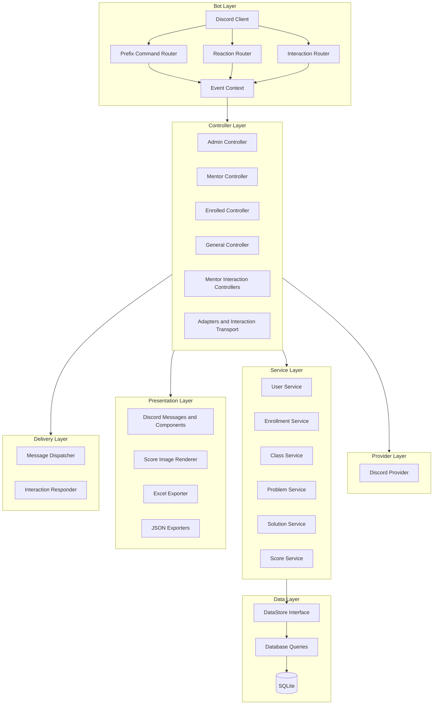
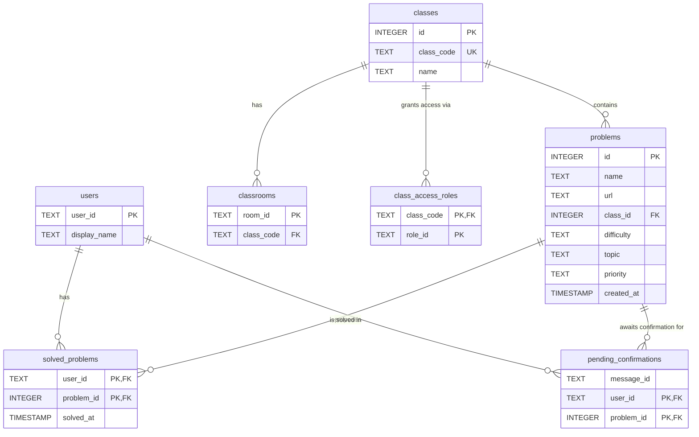

# Architecture

## Layers

The bot follows a layered architecture with clear separation of concerns:

| Layer | Responsibility | Key Packages |
|---|---|---|
| **Discord (Entry Point)** | Receives prefix messages, reactions, slash commands, modal submissions, and button interactions via `discordgo`. | `bot/` |
| **Command Routers** | The prefix router parses `!commands`; the interaction router dispatches slash commands, modals, and components. | `bot/commandrouter.go`, `bot/interactionrouter.go` |
| **Event Context** | Carries each Discord event and its dependencies into the controller handling it. | `context/` |
| **Reaction Router** | Handles emoji reactions for AC approvals and prefix-command confirmations. | `bot/reactionrouter.go` |
| **Controllers** | Handle requests, coordinate identity and permission checks, adapt inputs, call services, and deliver results. Prefix and interaction handlers belong to this layer. | `controllers/` |
| **Adapters and Interaction Transport** | Map transport values and errors, encode or decode Discord inputs and component identifiers, and prepare attachments through a shared downloader. | `controllers/adapters/`, `controllers/interactiontransport/` |
| **Providers** | Verify Discord roles and interact with External APIs (`DiscordProvider`). | `providers/` |
| **Services** | Own business rules and coordinate user, enrollment, class, problem, solution, and score operations independently of the command transport. | `services/` |
| **Data (Repository)** | Persist and query domain data through `DataStore`. Constraints, conditional writes, and transactions protect consistency at write time. | `data/` |
| **Presentation** | Build Discord messages and components, score images, and Excel/JSON exports from application results, without performing database operations or sending responses. | `presentation/` |
| **Dispatcher and Interaction Responder** | Deliver channel messages and reactions, and acknowledge, create, edit, or delete interaction responses through the Discord client. | `dispatcher/` |
| **Logger** | Structured logging via `logrus`. | `logger/` |
| **Custom Errors** | Typed errors per layer: `dataerr`, `serviceerr`, `discorderr`, `controllerserr`, `presentationerr`. | `customerr/` |

---

## Diagram

## Command Handling

Prefix (`!`) and slash (`/`) command handlers are part of the controller layer. Their routers live in `bot/` and select the appropriate handler. Controllers adapt each transport to the same application-service and persistence pipeline; presentation and delivery use the representation appropriate to the request. For example, `!ac` and `/ac` share proposal creation and resolution services while using different inputs and responses.

Business validation belongs in services; transport parsing, external identity lookups, and response formatting belong at the boundaries. Data operations enforce conditions that must hold at write time and use transactions for changes that must succeed or fail together. Controllers present service outcomes after the operation completes.

Command-specific workflows and input formats are documented in the [Command Reference](COMMANDS.md) and [Mentor JSON Batch Guide](MENTOR_BATCHES.md).

---

## Domain Concepts

To ensure clarity across the system, the bot utilizes the following domain concepts:

- **Enrolled User**: A user is considered "enrolled" or to have "access" to a class if they possess a Discord Role that has been linked to that class via the `class_access_roles` table (managed by `!link_roles`).
- **Active Student**: A user who has solved at least 1 problem (AC) in a specific class. This drives the `!users` and `!score` logic.

---

## Database Schema

The bot uses **SQLite** with 7 tables.

The DDL source of truth is [app/data/schema.sql](../app/data/schema.sql).

---

## Parameter Naming Conventions

| Format | Rule | Examples |
|---|---|---|
| `lowercase_snake` | Must be a single word (no spaces) | `class_code` → `basicos_1` |
| `CamelUpperCase` | Can contain multiple words (quotes not needed) | `ProblemName` → `Two Sum`, `ClassName` → `Basicos 2025` |

The `difficulty` parameter accepts: `Easy`, `Medium`, `Hard`, or `-` to skip.
The `topic` parameter accepts any single word, or `-` to skip.

---

## Confirmation Flow

Dangerous commands (`!remove_problem`, `!clear_class`, `!exterminate_class`, `!exterminate`) trigger a **two-step confirmation flow**:

1. The bot sends an embedded warning message with 👍 and 👎 reactions.
2. The original command author reacts:
   - **👍** → The operation is executed and the embed is updated to "EXECUTED".
   - **👎** → The operation is cancelled and the embed is updated to "CANCELLED".

For **AC proposals** (`!ac <problem_id>` by enrolled users):

1. The bot adds ✅ and ❌ reactions to the user's message and records the proposal in `pending_confirmations`.
2. A **mentor** reacts:
   - **✅** → The AC is approved and recorded in `solved_problems`. The ✅/❌ reactions are replaced by 🎈 (**Accepted**).
   - **❌** → The proposal is rejected. The ✅/❌ reactions are replaced by 🗣️ (**Rejected**).
