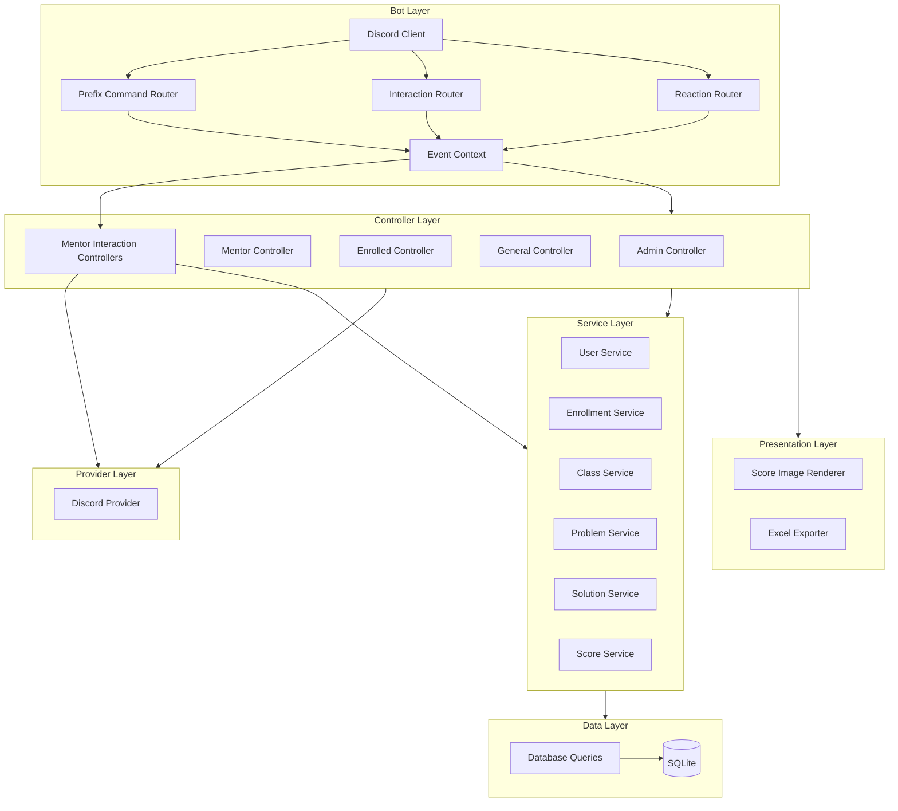
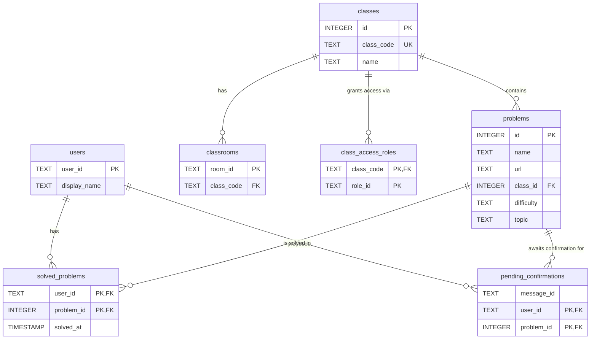

# Architecture

## Layers

The bot follows a layered architecture with clear separation of concerns:

| Layer | Responsibility | Key Packages |
|---|---|---|
| **Discord (Entry Point)** | Receives prefix messages, reactions, slash commands, modal submissions, and button interactions via `discordgo`. | `bot/` |
| **Command Routers** | The prefix router parses `!commands`; the interaction router dispatches slash commands, modals, and components. | `bot/commandrouter.go`, `bot/interactionrouter.go` |
| **Event Context** | Carries each Discord event and its dependencies into the controller handling it. | `context/` |
| **Reaction Router** | Handles emoji reactions for AC approvals and prefix-command confirmations. | `bot/reactionrouter.go` |
| **Controllers** | Orchestrate permission checks, contextual lookups, calls to services, and Discord response delivery. Mentor slash workflows live under `controllers/mentor/`. | `controllers/` |
| **Adapters and Interaction Transport** | Map request and response models and encode or decode Discord forms and component identifiers. | `controllers/adapters/`, `controllers/interactiontransport/` |
| **Providers** | Verify Discord roles and interact with External APIs (`DiscordProvider`). | `providers/` |
| **Services** | Apply business rules across user, enrollment, class, problem, solution, and score operations. `ProblemService` owns problem creation and patch batches; `SolutionService` owns AC batches. Both prepare and revalidate batches before writes. | `services/` |
| **Data (Repository)** | Framework-agnostic database operations via the `DataStore` interface. | `data/` |
| **Presentation** | Builds Discord embeds, form responses, batch previews and receipts, score images, and Excel exports. | `presentation/` |
| **Dispatcher and Interaction Responder** | Deliver prefix-command responses and acknowledge, defer, follow up, or edit slash-command interaction responses. | `dispatcher/` |
| **Logger** | Structured logging via `logrus`. | `logger/` |
| **Custom Errors** | Typed errors per layer: `dataerr`, `serviceerr`, `discorderr`, `controllerserr`, `presentationerr`. | `customerr/` |

---

## Diagram

## Discord slash workflows

Slash command interactions use a separate router from prefix commands and reactions. Mentor controllers authorize the actor, adapt submitted form values, call application services, and send private interaction responses. `/problem add` and `/problem edit` use forms for individual changes; the edit workflow keeps the problem identity and recorded ACs.

The JSON batch workflows use a prepare, preview, confirm sequence. Mentor controllers parse one typed batch and delegate validation and target resolution to `ProblemService` or `SolutionService` without writing. They retain the prepared snapshot in an expiring in-process cache. Confirm and Cancel buttons are bound to the submitting guild and actor. Confirmation checks current authority and revalidates the complete batch before execution. Problem creation and AC batches are persisted transactionally; problem edit batches apply patches in input order and can leave earlier entries applied if storage fails. A confirmed batch is consumed once and is not automatically retried. User-facing schemas and examples are in the [Mentor JSON Batch Guide](MENTOR_BATCHES.md); AI-authoring instructions are generated from [`web/llms.txt.template`](../web/llms.txt.template).

---

## Domain Concepts

To ensure clarity across the system, the bot utilizes the following domain concepts:
- **Enrolled User**: A user is considered "enrolled" or to have "access" to a class if they possess a Discord Role that has been linked to that class via the `class_access_roles` table (managed by `!link_roles`).
- **Active Student**: A user who has solved at least 1 problem (AC) in a specific class. This drives the `!users` and `!score` logic.

---

## Database Schema

The bot uses **SQLite** with 7 tables. 

The DDL source of truth is [app/data/schema.sql](../app/data/schema.sql).

---

## Parameter Naming Conventions

| Format | Rule | Examples |
|---|---|---|
| `lowercase_snake` | Must be a single word (no spaces) | `class_code` → `basicos_1` |
| `CamelUpperCase` | Can contain multiple words (quotes not needed) | `ProblemName` → `Two Sum`, `ClassName` → `Basicos 2025` |

The `difficulty` parameter accepts: `Easy`, `Medium`, `Hard`, or `-` to skip.
The `topic` parameter accepts any single word, or `-` to skip.

---

## Confirmation Flow

Dangerous commands (`!remove_problem`, `!clear_class`, `!exterminate_class`, `!exterminate`) trigger a **two-step confirmation flow**:

1. The bot sends an embedded warning message with 👍 and 👎 reactions.
2. The original command author reacts:
   - **👍** → The operation is executed and the embed is updated to "EXECUTED".
   - **👎** → The operation is cancelled and the embed is updated to "CANCELLED".

For **AC proposals** (`!ac <problem_id>` by enrolled users):

1. The bot adds ✅ and ❌ reactions to the user's message and records the proposal in `pending_confirmations`.
2. A **mentor** reacts:
   - **✅** → The AC is approved and recorded in `solved_problems`. The ✅/❌ reactions are replaced by 🎈 (**Accepted**).
   - **❌** → The proposal is rejected. The ✅/❌ reactions are replaced by 🗣️ (**Rejected**).
