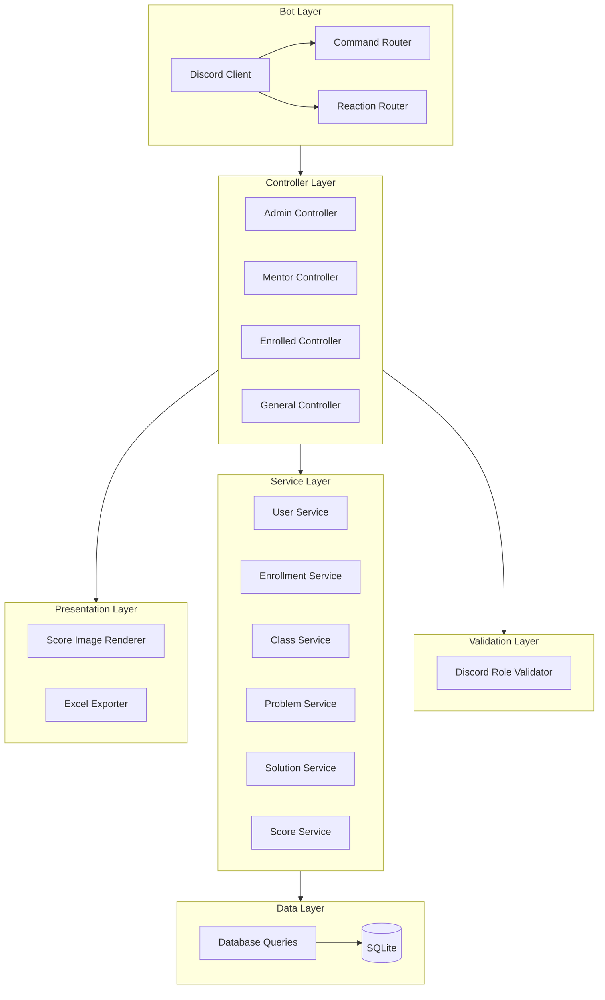

# Architecture

## Layers

The bot follows a clean **layered architecture** with clear separation of concerns:

| Layer | Responsibility | Key Packages |
|---|---|---|
| **Discord (Entry Point)** | Receives messages and reactions from Discord via `discordgo` session handlers. | `bot/` |
| **Command Router** | Parses `!commands`, resolves argument arity, and routes to the correct controller. | `bot/commandrouter.go` |
| **Reaction Router** | Handles emoji reactions for AC approvals and confirmation flows. | `bot/reactionrouter.go` |
| **Controllers** | Orchestrate permission checks, call services, and format Discord responses. Organized by role: `admin/`, `enrolled/`, `general/`, `mentor/`. | `controllers/` |
| **Adapters** | Transform data between layers (service models → presentation models). | `controllers/adapters/` |
| **Validators** | Verify Discord roles (`DiscordValidator`). | `validators/` |
| **Services** | Business logic layer. Six services: `UserService`, `EnrollmentService`, `ClassService`, `ProblemService`, `SolutionService`, `ScoreService`. | `services/` |
| **Data (Repository)** | Framework-agnostic database operations via the `DataStore` interface. | `data/` |
| **Presentation** | Rendering layer: generates score images (`image/`) and Excel exports (`excelizer/`). | `presentation/` |
| **Dispatcher** | Buffered, async message queue that handles sending all Discord responses (simple messages, embeds, reactions, files, paginated embeds, confirmation messages). | `dispatcher/` |
| **Logger** | Structured logging via `logrus`. | `logger/` |
| **Custom Errors** | Typed errors per layer: `dataerr`, `serviceerr`, `validatorerr`, `controllerserr`, `presentationerr`. | `customerr/` |

---

## Diagram

---

## Database Schema

The bot uses **SQLite** with 6 tables: `users`, `classes`, `problems`, `enrollments`, `solved_problems`, and `pending_confirmations`.

The full ER diagram is available in [DB Diagram.pdf](../DB%20Diagram.pdf). The DDL source of truth is [app/data/schema.sql](../app/data/schema.sql).

---

## Parameter Naming Conventions

| Format | Rule | Examples |
|---|---|---|
| `lowercase_snake` | Must be a single word (no spaces) | `class_code` → `basicos_1`, `user_name` → `jorge_ibanez` |
| `CamelUpperCase` | Can contain multiple words (quotes not needed) | `ProblemName` → `Two Sum`, `ClassName` → `Basicos 2025` |

The `difficulty` parameter accepts: `Easy`, `Medium`, `Hard`, or `-` to skip.
The `topic` parameter accepts any single word, or `-` to skip.

---

## Confirmation Flow

Dangerous commands (`!deregister`, `!remove_problem`, `!clear_class`, `!exterminate`) trigger a **two-step confirmation flow**:

1. The bot sends an embedded warning message with 👍 and 👎 reactions.
2. The original command author reacts:
   - **👍** → The operation is executed and the embed is updated to "EXECUTED".
   - **👎** → The operation is cancelled and the embed is updated to "CANCELLED".

For **AC proposals** (`!ac <problem_id>` by enrolled users):

1. The bot adds ✅ and ❌ reactions to the user's message.
2. A **mentor** reacts:
   - **✅** → The AC is approved and recorded.
   - **❌** → The proposal is rejected and removed.
