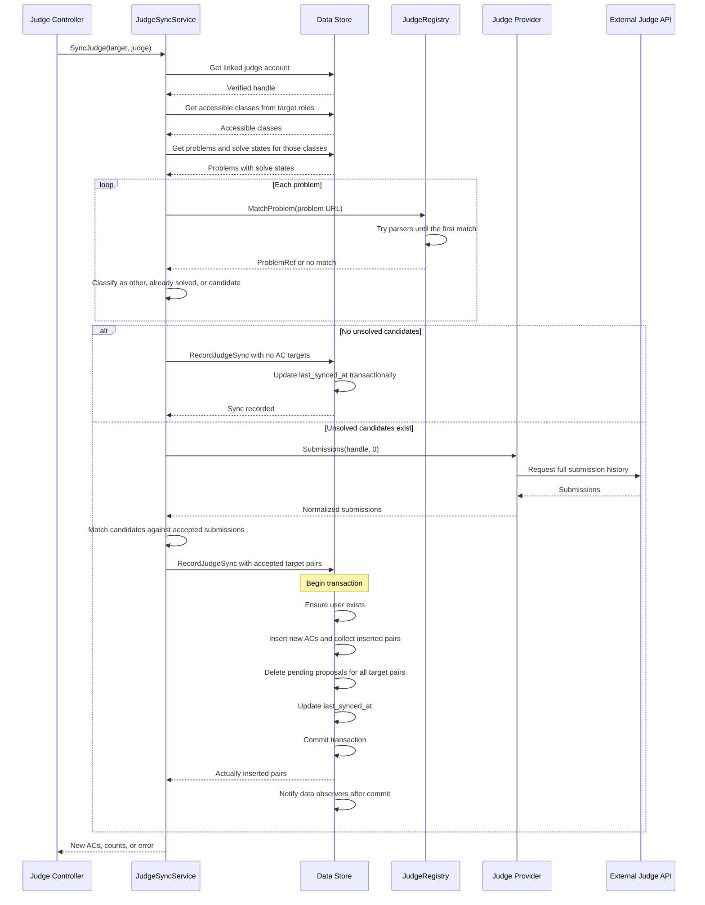
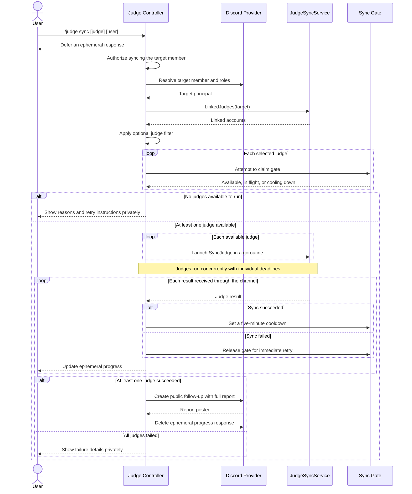

# Stage 3: `/judge sync` — Recording ACs from Judges

**Overview:** [00-overview.md](00-overview.md) · **Previous:** [02-accounts-and-linking.md](02-accounts-and-linking.md) · **Next:** [04-release-review.md](04-release-review.md)

## 0. Context for a New Contributor

Hurion is a Go Discord bot for competitive-programming classes (see `README.md`, `docs/ARCHITECTURE.md`). An **AC** is a row in `solved_problems(user_id, problem_id, solved_at)`. A student can see and solve the problems of every class whose access role they hold; the `class_access_roles` table maps classes to Discord role IDs. Enrollment is never stored; it's checked from the member's current roles.

Stages 1 and 2 added:
- the `Judge` port and `JudgeRegistry` (`app/services/judges.go`), with `MatchProblem(url)` mapping a problem URL to a `ProblemRef`
- the Codeforces client
- the `judge_accounts` table, holding verified handles per user and judge, with a `last_synced_at` column
- `JudgeAccountService`, the `/judge` command with `link`, `unlink`, and `whois`, and `app/controllers/judge/`

This stage adds `/judge sync`. It fetches a member's submissions from each selected judge and records an AC, **without mentor approval**, for every problem the member hasn't solved, can access, and has an accepted submission for on that judge. Then it posts a report.

Read before starting:
- `.ai/CONTEXT.md`, `.ai/TESTING.md`, ADR 0005, and overview sections 7 and 8
- **AC writes:**
  - `app/data/queries.go`: `AddACBatch` (around line 133), `AcceptPendingConfirmation`, and `notifyDataChanged` in `database.go`
  - `app/services/solution_service.go`: `ExecuteCreationBatch`, which calls `AddACBatch`
- **Class access:** `app/data/datastore.go` (`GetClassesByAccessRoles`), `pending_confirmations` in `schema.sql`
- **Permissions:** `app/controllers/mentor/mentor.go` (`canManageACs`: mentor, otherwise admin)
- **Patterns:** `app/controllers/mentor/ac_proposal_interactions.go`
  - `Followup` then `DeleteResponse`, the pattern for posting a public message after a private deferral
  - `AllowedMentions`
- **Callers and fakes of `AddACBatch` that must be updated:**
  - `app/services/solution_service.go:305`
  - `app/services/solution_service_test.go`
  - `app/data/queries_test.go` (`TestAddACBatch*`)
  - `integration/batch_execution_test.go` (`failingBatchStore`)
  - `workflow/batch_confirmation_test.go` (`uncertainBatchStore`)

**Prerequisites:** stage 2 merged. Branch `feat/judge-sync-3-sync` from `main`.

## 1. Goal

When this stage is done, `/judge sync [judge] [user]`:
1. Syncs the selected judge, or all of the target's linked judges.
2. Runs judges concurrently. Each judge is isolated: its own deadline, its own transaction, and its own cooldown.
3. Records exactly the new ACs, deletes stale pending proposals for them, updates `last_synced_at`, and refreshes the scoreboard export through the existing data-change callback.
4. Shows progress privately, then posts a public report listing exactly the ACs this call inserted. If every judge failed, it shows the errors privately instead.

Only mentors and admins may sync another member.

## 2. Data Layer

### 2.1 `AddACBatch` returns inserted pairs

Change the signature to `AddACBatch(targets []ACKey, users []User) ([]ACKey, error)`:
- Implement it with `INSERT ... ON CONFLICT(user_id, problem_id) DO NOTHING RETURNING user_id, problem_id`.
- Keep the transaction, the user upsert, and the post-commit `notifyDataChanged`.
- Return the inserted pairs in an unspecified order. Callers that need a count use `len`.

Update every caller and fake listed in section 0. `SolutionService.ExecuteCreationBatch` keeps its observable behavior (`Recorded = len(inserted)`).

Extract the insert-with-returning step into an unexported helper that takes a `*sql.Tx`, so section 2.3 reuses it.

### 2.2 Problems with solve state

```go
type ProblemSolveState struct {
    Problem Problem
    Class   Class
    Solved  bool
}
// GetProblemSolveStatesByClassIDs returns every problem in the given classes with
// whether userID has solved it, in one query ordered by class ID then problem ID.
GetProblemSolveStatesByClassIDs(userID string, classIDs []int64) ([]ProblemSolveState, error)
```

An empty `classIDs` returns an empty result without querying.

### 2.3 Transactional sync write

```go
// RecordJudgeSync, in one transaction: ensures the user, inserts the ACs (RETURNING),
// deletes pending_confirmations rows for every target pair, and sets
// judge_accounts.last_synced_at = CURRENT_TIMESTAMP for (userID, judge).
// Notifies data observers after commit. Empty targets still update last_synced_at.
RecordJudgeSync(user User, judge string, targets []ACKey) ([]ACKey, error)
```

Pending proposals are deleted for **all** target pairs, not only the inserted ones: once the judge confirms the AC, a pending proposal for it is stale either way. If the `judge_accounts` row is missing because it was unlinked mid-sync, return `dataerr.NotFoundError` and roll back everything.

Run `make generate` after the interface changes.

## 3. Service Layer

### 3.1 Types (`service_model/judge_sync.go`)

```go
type SyncedProblem struct { Problem Problem; Class Class }

type JudgeSyncResult struct {
    Judge           JudgeCode
    JudgeName       string
    Handle          string
    NewACs          []SyncedProblem    // inserted by this call, ordered by class code then problem ID
    AlreadyRecorded int                // accepted on the judge, but recorded by someone else meanwhile
    StillUnsolved   int // candidates without an accepted submission on the judge
    AlreadySolved   int // problems on this judge already solved in Hurion before the sync
    OtherProblems   int // accessible problems not hosted on this judge
    Err             error // nil on success; otherwise a serviceerr type
}
```

### 3.2 `JudgeSyncService` (`app/services/judge_sync_service.go`)

```go
type JudgeSyncService struct {
    Datastore data.DataStore
    Judges    *JudgeRegistry
}

// LinkedJudges returns the target's linked judges in registry order.
func (s *JudgeSyncService) LinkedJudges(userID string) ([]service_model.JudgeAccount, error)

// SyncJudge never panics and always returns a result; failures are reported in Err.
func (s *JudgeSyncService) SyncJudge(ctx context.Context, target service_model.Principal, judge service_model.JudgeCode) service_model.JudgeSyncResult
```

Add the service to `Services` through `NewServicesWithJudges`.

`SyncJudge` algorithm:
1. **Account:** `GetJudgeAccount(target.UserID, judge)`. If it's missing, set `Err = NotFoundInfoError` ("not linked").
2. **Accessible classes:** `GetClassesByAccessRoles(target.Roles)`, then `GetProblemSolveStatesByClassIDs`.
3. **Partition** each problem with `Judges.MatchProblem(problem.URL)`:
   - no match, or a match on another judge: `OtherProblems++`
   - match and solved: `AlreadySolved++`
   - match and unsolved: a candidate
4. **No candidates:** call `RecordJudgeSync(user, judge, nil)` to stamp `last_synced_at`, and return. **The judge is not called.**
5. **Fetch:** `Submissions(ctx, handle, 0)` and group the submissions by `ProblemRef`.
6. **Classify** each candidate: if it has any `Accepted` submission, it's an AC target; otherwise `StillUnsolved++`. Other verdicts aren't reported.
7. **Record:** `RecordJudgeSync(user, judge, targets)`. `NewACs` holds the candidates whose pairs were returned. `AlreadyRecorded = len(targets) - len(inserted)`.
8. **Errors:**

   | Source | Maps to |
   | --- | --- |
   | `judgeerr.HandleNotFoundError` | `NotFoundInfoError` ("handle no longer exists; link again") |
   | `RateLimitedError`, `UnavailableError`, context errors | `InternalError` with a retry message. Wrap the original so `errors.Is(err, context.DeadlineExceeded)` still works |
   | Datastore errors | `InternalError` via `MakeGeneralError` |

   Any error leaves the database unchanged.

Business rules stay here; the service knows nothing about Discord, cooldowns, or concurrency.

### 3.3 Per-judge synchronization sequence

The following diagram shows the successful execution paths for one judge. Failures return an error result to the controller. Each execution considers the problems in all classes accessible to the target member.



## 4. Discord Layer

### 4.1 Command

Add a subcommand to `/judge` in `discordcommands/judge.go`, and route it in `interactionrouter.go`:

```
sync  judge:<string choice, optional>  user:<USER, optional>
```

### 4.2 Controller (`app/controllers/judge/sync.go`)

Add `validator providers.DiscordValidator` and `fetcher providers.DiscordFetcher` to `InteractionController` and update its constructor and wiring. Add `syncGate`, an `otter` cache keyed by `{guildID, targetUserID, judge}` with an injectable clock. Its values are either `inFlight` or `cooldownUntil`.

Constants:
- `judgeSyncTimeout = 20 * time.Second` per judge
- `judgeSyncCooldown = 5 * time.Minute`
- `judgeSyncOverallTimeout = 60 * time.Second`

`HandleSyncInteraction`:
1. **Member:** require an identified member. Parse the options (judge code, optional target user ID).
2. **Defer privately:** `DeferredChannelMessageWithSource` with the ephemeral flag. If this fails, stop.
3. **Authorize:** if the target differs from the invoker, require mentor or admin (same logic as `canManageACs`). Otherwise edit the response: "Only mentors can sync another member."
4. **Target principal:** `common.GetMemberPrincipal(fetcher, guildID, targetID)`, which gives the target's **current** roles.
5. **Select judges:** `LinkedJudges(target)`.
   - None: private message suggesting `/judge link`.
   - A judge was requested but isn't linked: private message naming the judge. **No judge call.**
6. **Claim gates:** for each selected judge, claim the gate with `SetIfAbsent(inFlight)`.
   - If the gate is held by a cooldown or an in-flight sync, mark the judge **skipped**, with the remaining wait time.
   - If every judge is skipped, edit the private response with the reasons and stop.
7. **Run:** for each claimed judge, start a goroutine that calls `SyncJudge` with `context.WithTimeout(parent, judgeSyncTimeout)`, where `parent` has the overall timeout. Results go to a channel.
8. **One aggregator loop** (the handler goroutine) receives the results. After each one, it edits the private response with a progress view. **Only this goroutine talks to the responder.**
9. **Release gates:**
   - on success, replace `inFlight` with `cooldownUntil = now + judgeSyncCooldown`
   - on failure, invalidate the gate, so the user can retry immediately
10. **Final message:**
    - **At least one success:** post the full report as a **public** `Followup` (no ephemeral flag, `AllowedMentions` parse empty, so the target's mention renders without pinging). Then `DeleteResponse`. If the delete fails, edit the private response to "Report posted below."
    - **Everything failed:** edit the private response with every failure reason.

The handler must not return before every goroutine has finished, and it must recover panics inside the goroutines (report them as failures).

#### Sync orchestration sequence

The controller launches the available judges concurrently and aggregates their results. Only the handler goroutine sends progress updates and the final report to Discord.



### 4.3 Presentation (`app/presentation/discord/judge_sync.go`)

- `BuildJudgeSyncProgress(targetName string, results []JudgeSyncView) *discordgo.WebhookEdit`
- `BuildJudgeSyncReport(target service_model.User, results []JudgeSyncView) *discordgo.WebhookParams`
- `BuildJudgeSyncFailure(results []JudgeSyncView) *discordgo.WebhookEdit`

`JudgeSyncView` wraps a result, or a skipped or pending state, for presentation.

The report is one embed with one field per judge:
- **Title:** `🔄 Judge sync for <display name>`.
- **Successful judge:** `✅ Codeforces (Handle) — N new ACs`, then the new ACs grouped by class (`class_code · [#ID Name](url)`), then `Still unsolved: N · Already solved: N`.
- **Failed judge:** `⚠️ … — not synced: <reason>` with `Retry with /judge sync judge:<code>`.
- **Skipped judge:** `⏳ … — synced recently; try again in M min`.

Respect Discord limits: field value 1024 characters, at most 25 fields, 6000 characters in total. Truncate lists with `…and N more` and escape problem names.

## 5. Verification

### 5.1 Data unit tests

| Test | Assertions |
| --- | --- |
| `TestAddACBatchReturnsInsertedPairs` | With pairs that already exist, new pairs, and duplicates in the input: exactly the new pairs are returned. Existing `solved_at` values are unchanged |
| Existing `TestAddACBatch*` | Pass after mechanical updates. Rollback tests still roll back users and solves |
| `TestSQLiteSupportsReturning` | `SELECT sqlite_version()` is at least 3.35.0 |
| `TestGetProblemSolveStatesByClassIDs` | Correct `Solved` flags for two users across two classes. Problems of non-requested classes are excluded. Empty input makes no query. Ordering as documented |
| `TestRecordJudgeSync` | Inserts and returns the new ACs. Deletes pending proposals for **all** targets (also already-solved ones). Doesn't touch pending proposals for other pairs or other users. Sets `last_synced_at`. Empty targets only set `last_synced_at` |
| `TestRecordJudgeSyncRollsBackWhenAccountMissing` | No account row: `NotFoundError`, and no ACs, no deleted pending rows, and no user rows from this call |
| `TestRecordJudgeSyncNotifiesAfterCommit` | A registered data-change callback fires after commit (follow the pattern in `workflow/hook_test.go`) |

### 5.2 Service unit tests (`judge_sync_service_test.go`, mocks)

Table-driven, with an `assertFunc` per case:
- **Classification:** two classes and seven problems:
  - a CF unsolved problem with an AC → becomes a new AC
  - a CF unsolved problem with WA and TLE submissions → still unsolved
  - a CF unsolved problem with only pending submissions → still unsolved
  - a CF unsolved problem with no submissions → still unsolved
  - a CF solved problem → counted as already solved
  - an AtCoder URL → counted as an other problem
  - a group URL → counted as an other problem

  Assert every field of the result and the exact `RecordJudgeSync` arguments.
- **Inaccessible classes:** a problem in a class the target can't access is never a candidate. Its AC on the judge is ignored.
- **Race:** `RecordJudgeSync` returns fewer pairs than its targets, so `AlreadyRecorded` equals the difference and `NewACs` excludes them.
- **No candidates:** the judge's `Submissions` is **not** called (gomock strict), and `RecordJudgeSync` is called with nil targets.
- **Not linked:** `NotFoundInfoError`, with no judge call and no write.
- **Judge errors:**
  - `HandleNotFoundError` → `NotFoundInfoError`
  - `UnavailableError` wrapping `context.DeadlineExceeded` → `InternalError`, with `errors.Is(err, context.DeadlineExceeded)`
  - `RateLimitedError` → `InternalError`

  None of them write.
- **Datastore failure:** a read error yields `InternalError` with no judge call.

### 5.3 Controller and presentation unit tests

- **Presentation, with golden-style assertions on content:**
  - a three-class report with mixed sections
  - truncation with 300 new ACs: every field is under 1024 characters, the total is under 6000, and the "…and N more" count is correct
  - escaping of `*_~|` in problem names
  - failure-only output
  - skipped output
- **Gate** (fake `otter` clock):
  - claim succeeds once
  - a second claim during `inFlight` reports skipped
  - success sets the cooldown, which blocks for 5 minutes and frees at 5m+1s
  - failure frees the gate immediately
  - keys for different judges, targets, and guilds are independent

### 5.4 Workflow tests (`workflow/judge_sync_test.go`)

Extend the workflow harness:
- Make `recordingDiscordInteractionClient` goroutine-safe: add a mutex around its slices, and keep its API.
- Use two fake judges: `fakeJudge` from stage 2 registered as `codeforces`, and a second fake with code `atcoder`. Add `JudgeAtCoder` to `KnownJudgeCodes` **only inside the test**, through the registry; the command's choice list isn't used by the fake path.

  If adding a second code proves invasive, use one fake judge plus a second registry entry with a test-only code. The **behavior under test is isolation**, not AtCoder.
- Fake judges can be configured to block until a context deadline, or to fail.

| Test | Steps and assertions |
| --- | --- |
| `TestWorkflow_JudgeSync_RecordsNewACsAndPostsPublicReport` | 1. Seed a class, access role, and problems with CF URLs. Link through the stage 2 flow (not by seeding), and give the fake judge ACs on two problems.<br>2. Run `/judge sync`.<br>3. **Intermediate:** the first response is a private deferral.<br>4. **Final:** both ACs are in `solved_problems`, and `last_synced_at` is set. One public follow-up lists exactly those two problems. The private response was deleted. |
| `…_SecondSyncReportsNothingNew` | Advance the gate clock past the cooldown. Sync again: zero new ACs, and the report says so. No duplicate rows. |
| `…_CooldownSkipsRecentlySyncedJudge` | An immediate second sync gets a private "try again in 5 min" reply and makes **no** judge call (fake judge call counter unchanged). |
| `…_ClearsPendingProposalForSyncedProblem` | The student first proposes problem P via `/ac submit` (or `!ac`). Sync records P. The pending row is gone. A mentor pressing Approve on the old card gets the "already resolved" message, and only one `solved_problems` row exists. |
| `…_OneJudgeFailsOthersCommit` | Two linked judges. Judge B blocks past its deadline. Judge A's ACs are committed. The report shows A's ACs and a B failure with the retry hint. A is in cooldown, B is not: an immediate `judge:<B>` sync calls B again. B's `last_synced_at` is unchanged. |
| `…_AllJudgesFailIsPrivate` | Every judge fails. No public follow-up. The private response lists each reason. No database changes. |
| `…_JudgeFilterQueriesOnlySelectedJudge` | Two linked judges, `/judge sync judge:codeforces`: only that fake's call counter increments. |
| `…_RequestedJudgeNotLinked` | A private message, no judge calls. |
| `…_NoLinkedJudges` | A private message suggesting `/judge link`. |
| `…_OnlyMentorsSyncOthers` | A student syncing another member is refused, with no judge call. A mentor syncing the student succeeds and the ACs belong to the **student**. An admin without the mentor role also succeeds. |
| `…_OnlyAccessibleClassesAreSynced` | The student has class A's role but not class B's, and has ACs on problems in both. Only class A's problem is recorded. |
| `…_ReportDoesNotPing` | The public follow-up has `AllowedMentions` with empty `Parse`. |
| `…_ScoreboardExportTriggered` | Following `hook_test.go`: a registered data-change callback fires after a sync that records ACs. |

Run the whole suite under `-race`. Concurrency is part of this stage, so a race is a failure.

### 5.5 Manual verification in a test guild (record results in the PR)

Prerequisite: your Codeforces account is linked (stage 2), and you have the student role for a test class.
1. **Seed:** as a mentor, add three problems to the test class:
   - one you have AC'd on Codeforces (`/contest/{c}/problem/{i}` form)
   - one you have AC'd, in `/problemset/problem/...` form
   - one you have never attempted
2. **First sync:** `/judge sync`. You see a private "syncing…" message, then a public report with 2 new ACs and 1 still unsolved. Check `!score` and the web scoreboard.
3. **Cooldown:** `/judge sync` again immediately gives a private cooldown message.
4. **Undo:** a mentor runs `!undo_ac` for one of the problems. After the cooldown (or a restart, since cooldowns are in memory), sync re-records it.
5. **Permissions:** from a non-mentor account, `/judge sync user:@you` is refused. From a mentor account it works.
6. **Failure path:** start the bot with `CODEFORCES_API_URL=http://127.0.0.1:9` (nothing listening), then sync. You get a private failure message, the database is unchanged, and an immediate retry isn't blocked by a cooldown.
7. **Rate limit:** two members sync at the same moment. Both succeed, and the logs show the requests spaced at least 2.1 seconds apart.

### 5.6 Commands to run and report

```
make generate
go fmt ./... && go vet ./...
make test
go test -race -count=3 -run 'JudgeSync|AddACBatch|RecordJudgeSync' -v ./app/... ./workflow/... ./integration/...
```

`-count=3` shakes out flaky concurrency.

### 5.7 Definition of done

- [ ] All tests in sections 5.1–5.4 exist and pass with `-race -count=3`.
- [ ] Every `AddACBatch` caller and fake is updated, and the existing batch tests pass unchanged in intent.
- [ ] The manual steps in section 5.5 were performed, with outputs and screenshots in the PR.
- [ ] Only the aggregator goroutine calls the responder. Reviewers can confirm this by reading `sync.go`; note the line numbers in the PR.
- [ ] Synced ACs never reach a class the target lacks access to (covered by test).
